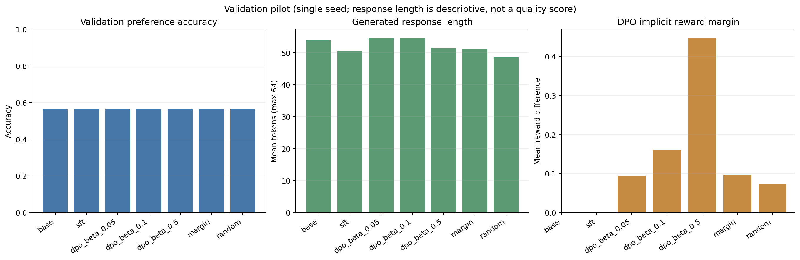

# DPO from scratch

A research-oriented implementation of supervised fine-tuning (SFT) and Direct Preference Optimization (DPO) using PyTorch and PEFT/LoRA. Training does not use TRL's `DPOTrainer`; TRL is pinned only to keep the research environment reproducible and available for later extensions.

## Current status

The SFT/DPO trainers, cache validation, checkpoint resumption, held-out scoring, generation export, train-only subset selection, and result aggregation are implemented. On the Colab Python 3.13.16 / PyTorch 2.11.0+cu130 Tesla T4 stack, 24 tests passed and one legacy TRL helper comparison was skipped. Qwen loading, LoRA injection, and two-step synthetic SFT and DPO pipeline smoke runs passed, including checkpoint/reference checks. A real-data, 128-example pilot and validation comparison were run on the T4; the full UltraFeedback experiments remain incomplete. Results below are pilot evidence, not claims about full-dataset performance.

## Setup

Use Python 3.11 or 3.12 and install the pinned requirements:

```bash
python -m venv .venv
source .venv/bin/activate  # Windows: .venv\Scripts\Activate.ps1
python -m pip install -r requirements.txt
```

The local dependency set was installed and checked in a clean Python 3.12 environment (`pip check` passed): PyTorch 2.5.1, Transformers 4.46.3, PEFT 0.13.2, Datasets 3.1.0, TRL 0.12.2, Accelerate 1.1.1, and PyYAML 6.0.2. For Colab, use `notebooks/colab_run.ipynb` and keep Colab’s preinstalled CUDA-enabled PyTorch. `requirements-colab.txt` pins Transformers 5.21.0, PEFT 0.21.2, TorchAO 0.18.0, Datasets 4.8.5, TRL 1.17.1, Accelerate 1.15.0, PyYAML 6.0.2, and Colab's `fsspec` 2025.12.0; it intentionally omits `torch` and `torchvision`. TorchAO is pinned because the Colab image's 0.10.0 package is rejected by PEFT 0.21.2. TRL 0.12.2 cannot be used with Transformers 5 because it requires Transformers below 4.47; the Colab pin uses TRL 1.17.1. Local CPU tests use the local dependency set. The Colab set installed without resolver conflicts and kept PyTorch 2.11.0+cu130. `pip check` reported only the Colab image's unrelated missing optional `jedi` dependency for its preinstalled IPython 7.34.0. See the [Colab runtime FAQ](https://research.google.com/colaboratory/runtime-version-faq.html). The local `requirements.txt` targets Python 3.11/3.12 and retains the tested PyTorch 2.5.1 pin. The default Qwen config uses fp16 and LoRA. Use `configs/tiny.yaml` for a CPU run; it downloads model and dataset artifacts from Hugging Face, so it is not an offline test.

## Actual pilot results

The pilot used Qwen2.5-0.5B-Instruct, UltraFeedback `train_sft` / `train_prefs`, seed 42, max length 512, 128 capped training examples, and 32 held-out validation examples. SFT completed one epoch (16 optimizer steps). DPO beta 0.05, 0.1, and 0.5 each started from the same saved SFT adapter and used the same 128 preference rows. The selection arms used the same SFT start and beta 0.1: 32 highest `score_chosen - score_rejected` margins versus a seeded random 32-row subset. The 128-row beta-0.1 run is the pilot full-candidate-pool arm. The selector did not read validation or test rows. This is a small pilot of the simplified data-selection procedure, not the paper's full method.

All seven checkpoints were evaluated on the same validation examples with greedy generation, batch size 1, and a 64-token generation cap. Each row is one seed and 32 examples; standard deviations are not applicable.

| Checkpoint | Beta | Preference accuracy | Mean implicit reward margin | Mean generated tokens |
|---|---:|---:|---:|---:|
| Base | — | 0.5625 | — | 53.88 |
| SFT | — | 0.5625 | — | 50.69 |
| DPO, full pilot pool | 0.05 | 0.5625 | 0.0931 | 54.66 |
| DPO, full pilot pool | 0.10 | 0.5625 | 0.1606 | 54.63 |
| DPO, full pilot pool | 0.50 | 0.5625 | 0.4474 | 51.56 |
| DPO, margin-selected 32 | 0.10 | 0.5625 | 0.0970 | 51.00 |
| DPO, random 32 | 0.10 | 0.5625 | 0.0743 | 48.59 |

Preference accuracy tied across all seven checkpoints on this small validation sample. The mean chosen-minus-rejected log-probability margins were negative while the medians were positive, so the aggregate margin distribution is strongly skewed; this warrants per-example analysis before drawing conclusions. The response-length median was 64 tokens for every checkpoint because the generation cap is 64; lengths are descriptive and do not establish quality. The mean log-probability margin is reported in [`metrics.csv`](results/pilot-128/evaluation/validation/metrics.csv), along with chosen/rejected scores and run settings. The generated responses and per-example length CSVs are stored alongside it. Training losses and resource measurements are under [`results/pilot-128`](results/pilot-128); six LoRA adapter checkpoints are copied locally but ignored by Git.



On the T4, SFT took 78.4 seconds (peak allocated 2,014 MiB); DPO over 128 pairs took 141.2–141.9 seconds per beta (peak allocated 2,333 MiB). Each 32-pair selection run took about 51 seconds. The shared seven-checkpoint validation evaluation took 851 seconds by Colab MCP process wall timing; peak memory for that multi-checkpoint pass was not instrumented. These timings are specific to this runtime and pilot configuration.

The full 61,135-row training splits, multiple-seed replications, final-test evaluation, and full-scale selection comparison have not been run. Google Drive authorization timed out, so pilot outputs were copied from ephemeral Colab storage into this local workspace; Drive-backed persistence and recovery remain unverified. Do not treat this pilot as a completed benchmark. `configs/pilot_128.yaml`, the selection manifests/config snapshots, `summary/run_resources.csv`, training logs, predictions, and response-length exports provide the actual run record. Adapter and optimizer checkpoints are excluded from Git by `.gitignore`.

## Training

```bash
python -m src.train_sft --config configs/default.yaml
python -m src.train_dpo --config configs/default.yaml --sft-checkpoint checkpoints/qwen25-05b/sft
```

SFT saves a PEFT adapter, tokenizer, and `sft_manifest.json` with the resolved base-model revision and tokenizer identity. DPO requires this manifest, pins both reference and trainable policy to the exact base revision, and validates the tokenizer. Before the policy is updated, the frozen SFT adapter is loaded once to compute reference log-probabilities for each training preference pair. Those scores are cached on disk, allowing the training process to keep only the trainable policy in accelerator memory. Cache identity includes adapter contents, base commit/content identity, dataset fingerprint and revision, split, subset/sampling settings, preprocessing version, tokenization identity, and sequence limit. Use `--force-reference-recompute` to rebuild it.

Train the beta sweep as separate runs:

```bash
python -m src.train_dpo --config configs/default.yaml --beta 0.05
python -m src.train_dpo --config configs/default.yaml --beta 0.1
python -m src.train_dpo --config configs/default.yaml --beta 0.5
```

Each beta override writes to `checkpoints/qwen25-05b/dpo-beta-{beta}`. Each run uses the same configured seed, SFT checkpoint, and data partition. For seed replications, use a separate config/output directory per seed.

## Preference-data selection experiment

The selector uses only the training preference split after its deterministic validation partition and `max_train_samples` cap. It defines the external score margin as `score_chosen - score_rejected`, measured before DPO updates, and selects the top `--subset-size` margins (ties broken by source row ID). A seeded uniform random subset of exactly the same size is also produced; the full arm is the entire configured training candidate pool. UltraFeedback's dataset card describes its chosen response as the highest GPT-4 overall-score completion and rejected as a randomly selected alternative; this experiment uses the exposed scalar `score_chosen` / `score_rejected` fields. It does not use DPO implicit margins, a pilot DPO model, validation, or test rows to select data. This is inspired by [Less is More](https://arxiv.org/abs/2502.14560), not a full reproduction.

Create selection artifacts and train the margin/random arms:

```bash
python -m scripts.select_preference_data --config configs/default.yaml --subset-size 6000 --output-dir outputs/selection/seed-42
python -m src.train_dpo --config configs/default.yaml --train-row-ids-file outputs/selection/seed-42/margin_subset.json --output-dir outputs/dpo/seed-42/margin --reference-logps-path outputs/reference/seed-42/margin.pt
python -m src.train_dpo --config configs/default.yaml --train-row-ids-file outputs/selection/seed-42/random_subset.json --output-dir outputs/dpo/seed-42/random --reference-logps-path outputs/reference/seed-42/random.pt
python -m src.train_dpo --config configs/default.yaml --output-dir outputs/dpo/seed-42/full --reference-logps-path outputs/reference/seed-42/full.pt
```

The three DPO runs must use the same saved SFT checkpoint and training settings, but distinct output directories and reference-cache paths as shown. The selector writes both ID manifests, all candidate scores/margins, the complete candidate ID list, seed, source dataset fingerprint, and the training config snapshot. Data loading rejects manifests from another dataset revision/fingerprint and any IDs in validation or outside the configured candidate pool. Set `data.train_row_ids_file` to a manifest in YAML instead of passing the CLI option when preferred.

Compare the three trained arms on validation with one shared generation/evaluation configuration:

```bash
python -m src.evaluate --config configs/default.yaml --split validation \
  --checkpoint base=base \
  --checkpoint sft=checkpoints/qwen25-05b/sft \
  --checkpoint margin=outputs/dpo/seed-42/margin \
  --checkpoint random=outputs/dpo/seed-42/random \
  --checkpoint full=outputs/dpo/seed-42/full \
  --beta margin=0.1 --beta random=0.1 --beta full=0.1 \
  --output-dir outputs/selection-evaluation/seed-42
```

The Colab notebook builds this validation comparison when the selection experiment toggle is enabled.

## Colab

Open [notebooks/colab_run.ipynb](notebooks/colab_run.ipynb). Commit and push local changes before cloning from GitHub. The notebook checks CUDA, preserves Colab’s managed PyTorch, installs dependencies from `requirements-colab.txt`, imports project modules, mounts Drive, and runs a Qwen finite-logit forward smoke check before training. On a T4, the synthetic pipeline smoke completed two SFT and two DPO optimizer steps, created/reloaded checkpoints and finite reference-logprob caches, and confirmed the DPO reference stayed frozen. This does not validate UltraFeedback training, full-run duration, or restart recovery. The notebook stores checkpoints/reference caches/logs/results on Drive, starts at 128 train examples and 512 tokens, and offers resume variables. Increase the sample cap only after the smoke run completes.

Resume from a periodic `checkpoint-N` folder (SFT and DPO checkpoints include adapter, optimizer, scheduler, RNG, run metadata, and batch cursor):

```bash
python -m src.train_dpo --config configs/default.yaml --sft-checkpoint checkpoints/qwen25-05b/sft --resume checkpoints/qwen25-05b/dpo-beta-0.1/checkpoint-100
```

Set `training.resume_from_checkpoint` in YAML for SFT resumption. The resume path must be a checkpoint produced by this implementation; older adapters without `sft_manifest.json` must be retrained to guarantee the exact DPO reference.

## Evaluation

```bash
python -m src.evaluate --config configs/default.yaml
```

Evaluation defaults to a validation partition made only from training data. Explicitly select `--split test` for final reporting after model/beta choices are fixed. It scores chosen-vs-rejected response log-probabilities and exports deterministic generations with token-length summaries; generated text is not automatically judged for quality. It writes one prediction JSONL and per-example `*_response_lengths.csv` per checkpoint plus `metrics.json` and `metrics.csv`. Generation settings are common to Base/SFT/DPO in one invocation. Length is descriptive, not a quality target. Final test data is not used by either trainer or validation selection.

## Tests

```bash
python -m unittest discover -s tests -v
```

The tests cover the closed-form DPO equation, prompt masking, EOS inclusion, padding exclusion, identical chosen/rejected responses, reference detachment, SFT adapter identity/freezing, cache invalidation, manifest revision/tokenizer validation, checkpoint state/resumption, equal-size/reproducible data selection, split isolation, aggregation, and plotting. The optional legacy TRL helper comparison is skipped because installed TRL 1.17.1 no longer exposes `DPOTrainer.dpo_loss`; the pilot does not establish multi-seed or full-dataset performance.

Aggregate actual evaluations across seeds (each evaluation run must be placed under a separate seed-specific directory):

```bash
python -m scripts.aggregate_results --root outputs/evaluation --output outputs/summary_metrics.csv
```

The output contains one row per metric/checkpoint/split/beta, with mean, sample standard deviation (`n-1`; blank for one seed), and seed count. With no runs, there are no result rows to report.

## Colab T4 checklist

1. Select T4 GPU and use a fresh managed Colab VM. Verify Python 3.13.16 and Colab-managed PyTorch 2.11.0+cu130 (or a newer compatible managed image). If the notebook reports an unsupported runtime, use Runtime → Disconnect and delete runtime and reconnect to a current T4 image. Do not install `requirements.txt` or replace the managed Torch/CUDA packages in Colab.
2. Verify CUDA and GPU name, then mount Drive and place `training.output_dir`, `dpo.reference_logps_path`, and evaluation outputs on Drive so runtime resets do not discard state.
3. Start with a short run using a small `max_train_samples` (for example 128) and `max_length: 512`; verify SFT, DPO, checkpoint resume, and evaluation before scaling.
4. The Qwen 0.5B tokenizer/model load and a short forward pass used about 1.0 GiB allocated VRAM on the tested T4. This does not establish training memory or throughput. If training runs out of memory, reduce sequence length first and keep per-device batch size at 1.
5. Train SFT once, then run each beta from that same SFT checkpoint. Tune/select on validation; evaluate the selected comparison on `test` only once.

## Design and limitations

See [docs/EXPLAINER.md](docs/EXPLAINER.md) for the objective, log-probability masking, reference-policy design, checkpoint/cache behavior, and research limitations.

The data-selection idea is a simplified experiment inspired by [Less is More](https://arxiv.org/abs/2502.14560), not a reproduction. The proposed later comparison is top reward-score margin, equal-size seeded random subset, and full training data. It omits the paper's implicit DPO margins and Bayesian multi-source aggregation.
